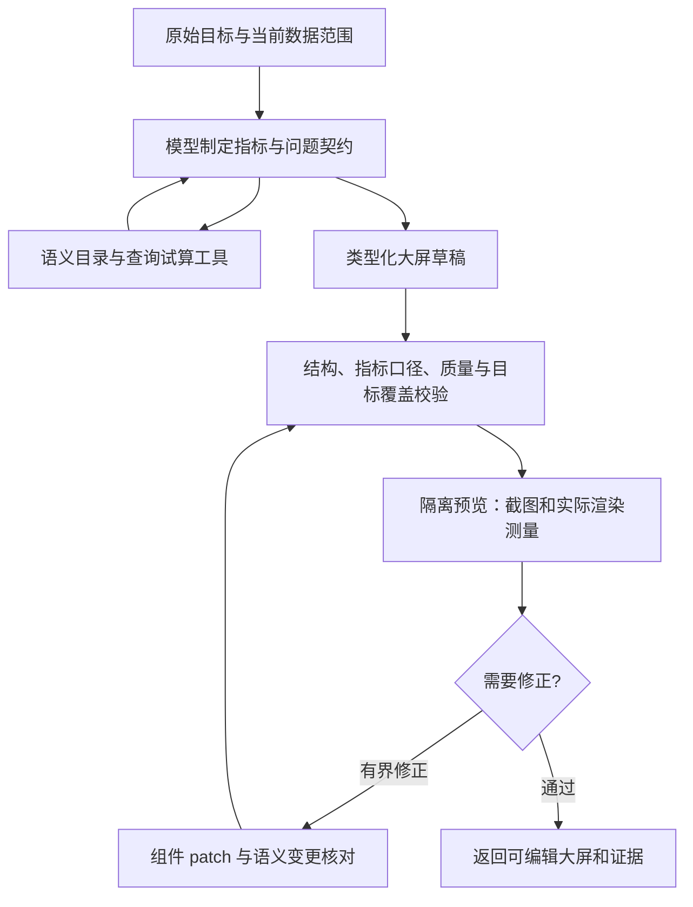

# 数据可视化模块 MCP 与大屏生成质量审查

审查日期：2026-10-27。基线：当前 1.5.5 源码。范围为字段发现、指标语义、受控查询、大屏生成、诊断、渲染反馈与修改。此次仅审查与合成数据验证，未修改生产功能或已安装应用。

## 结论

可以利用 MCP 提升质量，最值得接入的是**指标语义、按需数据探索、查询试算和渲染反馈**。收益来自模型获得并正确使用这些能力；仅把现有函数包装成 MCP，或者接入一个生成图片的工具，不会自动提高业务准确性。

当前已有 QuerySpec、QueryEngine、字段语义词典、领域指标目录、组件修正、质量诊断和版本记录，应复用这些能力形成工具循环。建议先修正下面的质量缺口，再用 MCP 开放工具。进程内调用同一工具契约也能实现第一阶段收益；存在跨进程、平台或外部设计工具需求时，MCP 的标准接口才产生额外价值。

## 现有链路

通用生成：语义路由 → 读取本地字段画像 → 一次模型输出完整 DashboardSpec → 由 QuerySpec 派生语义蓝图 → 结构与查询校验 → 执行查询 → 再校验 → 返回大屏。失败最多再生成一次。

已具备的基础：

- 真实查询计算数据，不让模型填充统计数字；QueryEngine 校验字段、类型和计算约束。
- DashboardSpec 与语义绑定校验、组件布局、增量 patch、取消和执行记录。
- 独立质量诊断，能识别空结果、截断、重复查询、分类过多等问题。
- 领域模式具有指标定义、公式版本、来源、时间口径、证据要求与保存门禁。
- 平台 MCP 已可查询远端字段和记录，但尚未接入通用可视化的数据探索链路。

## 主要发现

### 1. P1：字段目录截断，且业务语义没有完整交给模型

[catalogForPrompt](C:/Users/feng2/Documents/visslmRequirement/src/main/experts/visualization-agent.ts:1713) 将安全字段截为前 100 个，并只提供字段名、别名、类型、覆盖率、基数和少量样例。FieldProfile 已有的 `businessMeaning`、`unit`、`valueLabels` 未进入该目录。

合成探针输入 105 个合法字段，将用户明确要求的“关键评审延迟”放在最后：模型最终仅收到 100 个字段，目标字段消失；业务定义、单位、枚举解释也全部缺失。

影响：字段很多时，模型可能选相近但错误的属性；对编码状态、百分比和时间单位缺少依据。单纯换模型或增加图表数量无法消除这类信息缺失。

建议：用可分页的字段搜索/详情工具按需发现，并返回业务定义、单位、编码映射及关联关系。明确引用的字段必须能精确取回；目录尚未查完与字段确实不存在应返回不同状态。

### 2. P1：生成成功未闭合质量诊断与真实渲染反馈

[generate](C:/Users/feng2/Documents/visslmRequirement/src/main/experts/visualization-agent.ts:2866) 成功条件主要是结构、语义绑定和查询通过。独立的 [diagnoseDashboard](C:/Users/feng2/Documents/visslmRequirement/src/main/dashboards/diagnostics.ts:16) 没有纳入通用生成的自动修正循环；编辑器在用户打开[质量面板](C:/Users/feng2/Documents/visslmRequirement/src/renderer/src/dashboard/DashboardStudio.tsx:1920)后才执行诊断。领域保存门禁覆盖 domainContext 大屏，普通大屏直接经过该门禁的兼容分支。

合成探针生成了含 8 类环图的合法大屏：生成只调用一次模型并成功返回，随后诊断检出 `pie-too-many-categories`。这证明“生成通过”与现有质量能力尚未连通。

现有 PNG 捕获用于[导出](C:/Users/feng2/Documents/visslmRequirement/src/renderer/src/dashboard/DashboardStudio.tsx:1994)，生成模型没有收到实际截图、文本溢出、图例遮挡、渲染完成状态或控制台错误。数值布局合法也不能证明实际排版清晰。

建议：依次提供诊断与预览工具，返回结构化问题、组件 ID、截图及几何测量；只对问题组件生成受控 patch，再复验。诊断阈值属于图表质量约束，不应重新引入基于用户句子关键词的任务触发规则。

### 3. P1：自动修正工具可能改变指标含义，不能直接交给自主工具循环

[repairMeasures](C:/Users/feng2/Documents/visslmRequirement/src/main/dashboards/component-repair.ts:82) 在 sum/avg 等原字段不可用时，会选择 `numeric[0]`；没有数值字段则可能改为记录数。

合成探针把“成本 cost_amount 求和”交给只有工时字段的数据集：底层适配器将指标改成 `effortHours`，新查询类型校验仍通过。动作文本记录了替换，但缺少“成本与工时业务含义不一致”的约束。本探针验证的是底层适配器，不代表所有上层保存路径都会接受该修改。

建议：MCP 修正工具默认只修结构与展示；字段、单位、分母、粒度、过滤条件和公式的改变必须返回 `semanticChanges`，重新核对指标契约。无法保持业务含义时返回不可修复或需要澄清，不能为了通过校验换成其他可计算指标。

### 4. P2：整份 JSON 生成与反推蓝图，仍缺少对用户目标的独立验收

[generateSpec](C:/Users/feng2/Documents/visslmRequirement/src/main/experts/visualization-agent.ts:3211) 没有为模型提供 tools。模型生成前看不到试算后的分布、空值、异常值和分母；失败重试只传 `previousValidationErrors`，未传上一份候选大屏，因而可能重做无关部分。

当前蓝图由已选的查询[反向派生](C:/Users/feng2/Documents/visslmRequirement/src/main/experts/visualization-agent.ts:2127)，可以证明组件与查询互相一致，不能单独证明这些指标覆盖了用户的问题。通用生成 schema 也未开放 QueryMeasure 已支持的 `formula` 与 `comparison`，限制了复合指标的表达。

建议：先形成与原始目标对应的指标/问题契约，再探索数据和试算；生成后对照该契约验收。复杂指标复用领域指标目录或受控公式编译器。每轮保留 draftId/revision，修正采用 patch，并固定数据快照，避免不同组件使用不同数据口径。

### 5. P2：平台 MCP 与可视化尚未贯通，现有客户端也不是通用 MCP 接入层

通用大屏使用 [new QueryEngine(db)](C:/Users/feng2/Documents/visslmRequirement/src/main/index.ts:1850)。领域 platform-adapter 是本地数据的指标/字段映射，不意味着每次生成都会经 MCP 获取实时数据。[语义路由](C:/Users/feng2/Documents/visslmRequirement/src/main/assistant/intent-router.ts:184)目前也限制 platform 来源仅用于 record_query。

[PlatformMcpClient](C:/Users/feng2/Documents/visslmRequirement/src/main/assistant/platform-mcp.ts:26) 是服务于内置平台的窄客户端：固定旧版握手、要求 `visslm_call_api`、只解析特定 text JSON，并限制两个只读端点。这些限制适合该平台连接器，但不能直接拿来调用图表、浏览器或通用语义 MCP。

建议：平台取数先落为有版本和来源的只读快照，再复用 QueryEngine；将 MCP 发现、协议协商、结果类型解析与平台业务逻辑分开。保留宿主的作用域、凭据隔离、超时、取消和审计约束。

## MCP 方案取舍

| 能力 | 建议 | 预期价值与限制 |
| --- | --- | --- |
| VISSLM 自有语义/分析工具，经进程内契约及 MCP 暴露 | 最高优先级 | 复用字段词典、领域指标目录、QueryEngine；补齐真实口径与试算，避免业务语义漂移 |
| VISSLM 自有大屏预览/诊断工具 | 最高优先级 | 用同一实际渲染器返回截图、溢出、图例和渲染错误；修正可回到原 DashboardSpec |
| Microsoft Playwright MCP | 适合原型验证、集成验收 | 官方支持 CDP、页面快照、截图和控制台检查，可验证隔离的桌面预览页；集成 Electron 实际窗口仍需专项验证。运行时可收敛为应用专用预览工具，减少通用浏览器权限与上下文 |
| AntV MCP Server Chart | 可选参考和导出能力 | 提供多种图表，但其图表服务返回图片 URL，并不直接返回本应用可编辑、可查询、可版本化的 DashboardSpec。默认调用远端服务；使用业务数据前应选择合适的私有部署与适配路径 |
| 将全部本地函数搬到 MCP，维持原来整份 JSON 调用 | 收益低 | 增加协议与进程成本，却不补齐语义、试算和反馈链路 |

协议依据：MCP 工具定义支持输入/输出 schema、结构化结果及图像等内容；模型工具调用与宿主执行循环仍需应用实现。`structuredContent` 是工具结果，不等于模型生成已经正确。见 [MCP tools](https://modelcontextprotocol.io/specification/2026-07-28/server/tools)。

官方方案依据：[Playwright MCP](https://github.com/microsoft/playwright-mcp)、[AntV MCP Server Chart](https://github.com/antvis/mcp-server-chart)。AntV 的默认服务与私有部署机制已核对其 README。

当前官方版本已发布 2026-07-28；扩展接入不能假设所有服务都使用现有 2025-06-18 握手，应选定并测试兼容版本。官方 SDK 已提供新旧协议协商选项，逐次启动的本地服务还需考虑探测延迟。见 [协议发布说明](https://blog.modelcontextprotocol.io/posts/2026-07-28/)与 [TypeScript SDK protocol versions](https://ts.sdk.modelcontextprotocol.io/v2/protocol-versions)。

## 推荐工具契约与流程

工具名称为本次设计建议，尚未实现：

| 工具 | 核心输入 | 核心输出 |
| --- | --- | --- |
| `search_fields` / `get_field` | 业务目标、scopeRef、cursor 或字段 ID | 字段定义、别名、单位、枚举解释、覆盖率、分页状态 |
| `get_metric_definition` | metricId、scopeRef | 定义、公式版本、分母、时间口径、来源、适用范围与可计算性 |
| `preview_query` | QuerySpec、snapshotId | 小样本、总量、分布、空值、截断、查询校验问题与数据来源 |
| `validate_dashboard` | draftId、revision | 结构/查询/语义/目标覆盖与质量问题；每项关联组件 ID |
| `render_preview` | draftId、revision、桌面 viewport、theme | previewId、截图、几何测量、渲染完成状态、控制台错误 |
| `apply_dashboard_patch` | draftId、expectedRevision、类型化 operations | 新 revision、变更摘要、semanticChanges、复验结果 |

scopeRef 与 snapshotId 由宿主绑定，不接受模型借工具参数扩大数据范围。指标定义查找可以使用语义检索或目录匹配，但不得通过用户句子中的业务词直接触发任务或覆盖计划。

现有 `ModelChatInput` 有 tools 能力，适合作为工具调用桥接基础；但 [ModelMessage](C:/Users/feng2/Documents/visslmRequirement/src/main/model-client.ts:18) 的用户消息目前以字符串为主，没有统一图像输入契约。读取本机 Ollama 能力声明显示 `qwen3.8:27b` 支持 vision/tools；要使用截图反馈仍需完善多模态消息转换，并验证实际模型表现。第一阶段也可先传结构化布局诊断，不依赖视觉模型。

## 实施优先级与验收

1. **第一阶段：补信息与口径。** 修复目录语义丢失和截断；建立可按需调用的字段/指标/试算契约；限制自动修正对业务指标的改变。复用本地实现，不必先新增外部服务。
2. **第二阶段：闭合质量反馈。** 将已有诊断纳入生成，添加隔离预览工具，保留草稿和修正记录。先设少量修正轮次、工具次数与时间预算，以评测调整；禁止恢复关键词兜底。
3. **第三阶段：按需 MCP 扩展。** 统一客户端接入跨进程语义、平台数据或浏览器工具。AntV 作为可选能力，保留本应用 QuerySpec、主题和编辑模型。

同一模型、同一数据快照、同一目标集对比：当前链路、本地工具循环、MCP 工具循环。记录业务指标正确率、目标覆盖率、首轮/最终通过率、渲染缺陷率、修正后语义变化、P50/P95 延迟、token 与工具开销。借此区分工具能力本身的收益与 MCP 传输的增量收益。

建议评测至少覆盖：100+ 字段、编码状态、单位/分母混淆、多个日期、指标不可计算、高基数、空数据、复合比率、主题切换、长标题、局部修改、实时平台快照和提示注入。质量阈值需结合基线制定，此次未做接入前后模型 A/B，不能承诺提升百分比。

## 验证记录

- [合成探针源码](C:/Users/feng2/Documents/visslmRequirement/artifacts/visualization-mcp-audit/probe.ts)与[结果](C:/Users/feng2/Documents/visslmRequirement/artifacts/visualization-mcp-audit/probe-results.json)：确认目录丢字段和语义、未提供 tools、formula 未暴露、质量诊断未闭环、底层修正可能改变指标含义。
- `smoke:dashboard-quality`、`smoke:dashboard-ai-context`、`test:platform-mcp-analysis` 均通过，表明已有查询/修正/诊断/MCP 平台能力可复用，不代表已实现自主质量闭环。
- `smoke:visualization-regression` 当前主要检查用例目录与路由，不能把其用例数量当成真实模型生成质量通过率；后续需要执行实际生成并验收指标与渲染。
- 所有探针使用合成数据，未向第三方图表服务发送数据，未变更当前安装版本。
